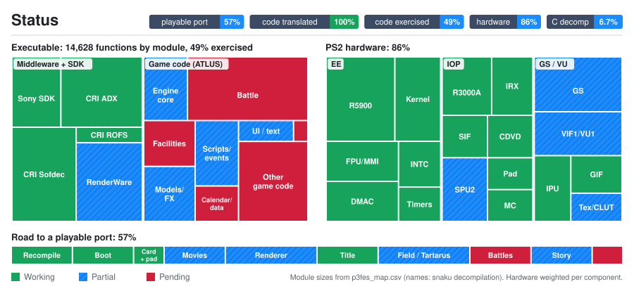

<div align="center">

<picture>
  <source media="(prefers-color-scheme: dark)" srcset="p3fes/branding/logo-dark.png">
  
</picture>
**An attempt at a static recompilation of *Shin Megami Tensei: Persona 3 FES* (NTSC-U `SLUS-21621`)**<br>
The game's MIPS R5900 code is statically recompiled to C++ and run on a reimplementation of the PS2 hardware. No emulator is involved.


</div>

> [!IMPORTANT]
> No game files are included: no ELF, IRX modules, `.CVM` archives or code generated from them.
> You need **your own copy** of Persona 3 FES, NTSC-U, PS2 ID **`SLUS-21621`**, matching the
> [Redump record](http://redump.org/disc/4125/). The port is built against that disc's executable:
>
> | File | SHA-1 |
> |---|---|
> | `SLUS_216.21` | `7ca061aac239e53e86bcd4c0ce8e19e987d8a75f` |

## Status



<sub>Generated from <a href="p3fes/status/status.toml"><code>p3fes/status/status.toml</code></a> by <code>p3fes/scripts/status_chart.py</code>. 🟩 working · 🟦 partial · 🟥 pending.</sub>

**Where it stands:** the game boots from its own CVM archives, detects the memory card and controller, plays the opening movie with sound through PCSX2's GS, and reaches the title screen and the *The Journey* / *The Answer* menu. The menu background is still corrupted, and the 2-core test VM runs at about 0.75× speed with the EE/IOP thread as the bottleneck. Next up: the menu background, then New Game.

| Milestone | |
|---|:---:|
| Recompile all 14,628 functions of `SLUS_216.21` | ✅ |
| Boot: EE kernel, original IRX modules, CVM archives | ✅ |
| Memory card (8 MB `.ps2`) and controller | ✅ |
| Opening movie: video (IPU) and audio (ADX over SPU2 AutoDMA) | ✅ |
| PCSX2 GS renderer (OpenGL / software) | ✅ |
| Movies at full speed | 🔧 |
| Title screen | ✅ |
| Menus (*The Journey* / *The Answer* background) | 🔧 |
| Field, Tartarus, battles, events | ⏳ |
| Widescreen, upscaling, 60 FPS | ⏳ |

## Goal

A **fully playable** Persona 3 FES, covering *The Journey* and *The Answer* from the opening movie to the credits,
as a native executable. Accuracy comes first, with PCSX2 as the reference. Once the game is playable, the port adds
widescreen, higher internal resolution and 60 FPS with frame interpolation.

## How it works

```
SLUS_216.21 ──► function map (14,628) ──► ps2_recomp ──► C++ (one file per function)
                                                               │
   ps2xRuntime  EE kernel HLE · DMAC · GIF/GS · VIF1/VU1 · IPU ─┼─► native executable
   ps2xIOP      R3000A interpreter running the game's own IRX · SPU2 · SIO2
   pcsx2gs      PCSX2's GS (OpenGL / software) behind a small C API
```

<details>
<summary><b>EE: static recompilation</b></summary>

`ps2xRecomp` decodes every function in the map and emits C++ against an `R5900Context` (128-bit GPRs, HI/LO pairs,
FPU and VU0 state). Delay slots, 64-bit compares and MMI lane semantics are translated explicitly. Direct calls are
C++ calls. Indirect jumps go through a dispatcher that maps a guest PC to a compiled function or a mid-function entry.

| | |
|---|---|
| Functions recompiled | 14,423 |
| Bound to runtime HLE | 205 (EE kernel, SIF, CD, pad, memory card libraries) |
| Kept as guest code | Sony `libmpeg` / `libipu`, so the game's MPEG player runs on the emulated IPU |
| Indirect-jump fallback entries | 3,910 functions (453,264 entries) |
| Recovered jump tables | 14 |

</details>

<details>
<summary><b>Runtime and hardware</b></summary>

- **EE kernel (HLE):** threads, semaphores, event flags, alarms, interrupt handlers and VBlank/HBlank timing.
- **DMAC:** all channels, including scratchpad chain and interleave modes, which Sofdec's motion compensation uses.
- **IPU:** the MPEG-1/2 decoder adapted from PCSX2.
- **GS:** a CPU rasterizer and an OpenGL backend with an optional render thread. PCSX2's GS is being integrated as a
  shared library (`third_party/pcsx2-gs`) fed through an observer on the GIF stream.
- **VIF1/VU1:** interpreted, or compiled ahead of time from captured microprograms.
- **IOP:** the game's original IRX modules (`SIO2MAN`, `PADMAN`, `MC2_S1`, `LIBSD`, `CRI_ADXI`, `SKSOUND`, …) run on an
  R3000A interpreter over an HLE IOP kernel. SPU2 handles voices and ADMA streaming, and SIO2 handles PCSX2-format
  memory cards.

| Middleware | Role | State |
|---|---|:---:|
| CRI Sofdec + Sony `libmpeg` | FMV (`.SFD`, MPEG-1 640×448) through the IPU | ✅ |
| CRI ADX (`CRI_ADXI.IRX`) | Music and movie audio over SPU2 AutoDMA | ✅ |
| CRI ROFS / CVM | Disc archives | ✅ |
| RenderWare 3.x | 2D/3D engine | 🔧 |
| ATLUS sound (`SKSOUND`/`MODHSYN`) | Effects and sequenced audio | 🔧 |

</details>

<details>
<summary><b>Repository layout</b></summary>

```
p3fes/                 Persona 3 FES config: p3fes.toml, function map, analyzer output, run.bat, scripts, status
ps2xRecomp/            Recompiler: R5900 decoder (rabbitizer) and C++ emitter
ps2xAnalyzer/          ELF analyzer that proposes stubs and entry points
ps2xRuntime/           EE runtime: kernel, DMAC, GS, VIF/VU, IPU, input, host window
ps2xIOP/               IOP: R3000A interpreter, HLE kernel and libraries, SPU2, SIO2
third_party/pcsx2/     Subset of PCSX2 at 2954ebe (GS, common, libraries)
third_party/pcsx2-gs/  PCSX2's GS as a shared library with a C API
```

</details>

## Building

See [`p3fes/README.md`](p3fes/README.md). In short:

1. Build `ps2xRecomp`, copy `SLUS_216.21` from your `SLUS-21621` disc (check its SHA-1 above) next to `p3fes/p3fes.toml` and run `ps2_recomp p3fes.toml`.
2. Copy the generated C++ into `ps2xRuntime/src/runner/` and its two headers into `ps2xRuntime/include/`.
3. Build `ps2xRuntime` (Windows: llvm-mingw or MSVC).
4. Put the executable, `run.bat`, `SLUS_216.21`, `SYSTEM.CNF`, `LIB31\` and the `.CVM` files in one folder.

<details>
<summary><b>Runtime options</b></summary>

| Variable | Effect |
|---|---|
| `PS2X_CALLBACK_STACK_TOP=0x100000` | Required: keeps interrupt/callback stacks clear of the main stack |
| `PS2X_GS_RENDERER=pcsx2` / `pcsx2-sw` | PCSX2's GS, hardware (OpenGL) or software renderer (`pcsx2gs.so`/`.dll` next to the executable) |
| `PS2X_PCSX2_SCALE=2` | PCSX2 internal resolution multiplier |
| `PS2X_PCSX2_OPTIONS=` | PCSX2 image options, `key=value;…` (see `third_party/pcsx2-gs/include/pcsx2gs_api.h`) |
| `PS2X_GS_GPU=1` | Built-in OpenGL GS backend instead of the CPU rasterizer |
| `PS2X_GS_THREAD=1` | Run the GS backend on its own thread |
| `PS2X_MEMCARD1=<path>` / `none` | Memory card for slot 1 (default `memcards/Mcd001.ps2`) |
| `PS2X_PAD_DEADZONE=0.15` | Analog stick deadzone |
| `PS2X_HIDE_DEBUG_UI=1` | Hide the developer overlay |
| `PS2X_AUDIO=0` | Disable host audio |
| `PS2X_AUDIO_DUMP=<file>` | Dump the SPU2 output (s16le stereo 48 kHz) |
| `PS2X_PROFILE=<file>` | Linux sampling profiler; summarise with `p3fes/scripts/prof_report.py` |

Debug traces: `PS2X_SPU2_DIAG`, `PS2X_GS_DIAG`, `PS2X_IPU_TRACE`, `PS2X_DMA_LOG`, `PS2X_CD_LOG`, `PS2X_IOP_CD_LOG`,
`PS2X_EE_TRACE_CALLS`, `PS2X_LOG_SUSPEND`.

</details>

## Credits

- Logo lettering: [Faktos](https://maylett.net/cmd/faktos.html) and [BM Space](https://www.dafont.com/bm-space.font) (free font).
- [PS2Recomp](https://github.com/ran-j/PS2Recomp) by ran-j and contributors: the recompiler and runtime this port is built on.
- [god-of-war-recomp](https://github.com/KIexster/god-of-war-recomp) by KIexster: SPU2, SIO2, IOP and VU1 work and many
  EE/GS fixes, merged here, plus the status map design.
- Taylor N. Albarnaz / LightVelox's Shadow of the Colossus fork of PS2Recomp: the OpenGL GS backend (via god-of-war-recomp).
- [urban-reign-recomp](https://github.com/thiagordsfx/urban-reign-recomp) by thiagordsfx: the PCSX2 GS bridge design.
- [PCSX2](https://github.com/PCSX2/pcsx2): the IPU and GS, and the accuracy reference.
- [ps2-web-recomp](https://github.com/snuri00/ps2-web-recomp): SPU2, IPU and GPU GS reference.
- The [snaku Persona 3 FES decompilation](https://github.com/snaku/Persona3-FES-Decompilation), for function names.
- The [Persona 4 decompilation](https://github.com/Raikaru/Persona4-Decompilation) by Raikaru: names for shared
  engine, RenderWare and CRI functions, transferred by `p3fes/scripts/p4_names.py` (`p3fes/names/p4_names.csv`).

*Persona 3 FES* is © ATLUS / SEGA. This is an unofficial, non-commercial fan project, not affiliated with or endorsed
by ATLUS or SEGA. Licensed under **GPL-3.0** (PS2Recomp, PCSX2 and god-of-war-recomp code is GPL); distributing a
build means providing its source.
